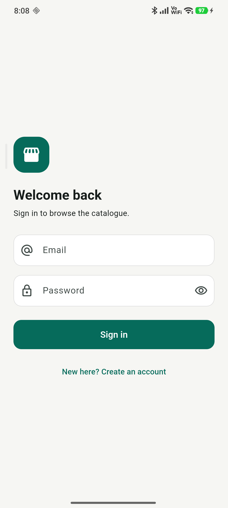
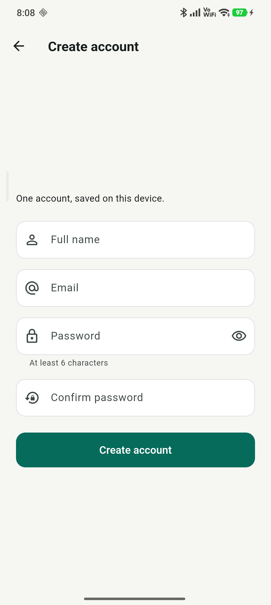
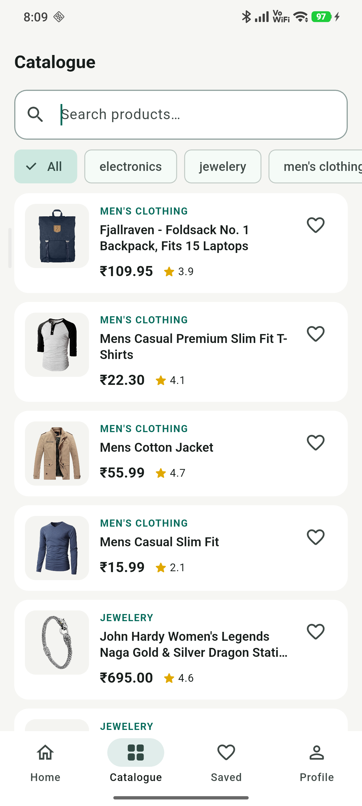
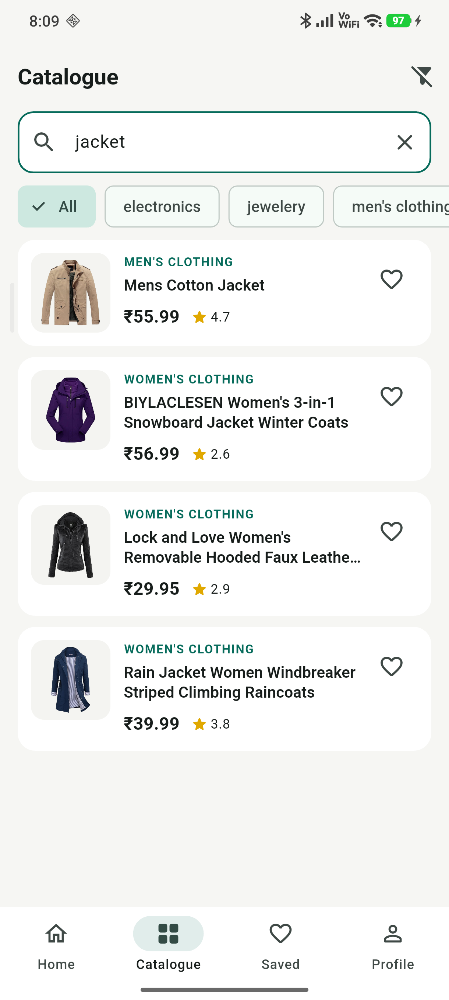
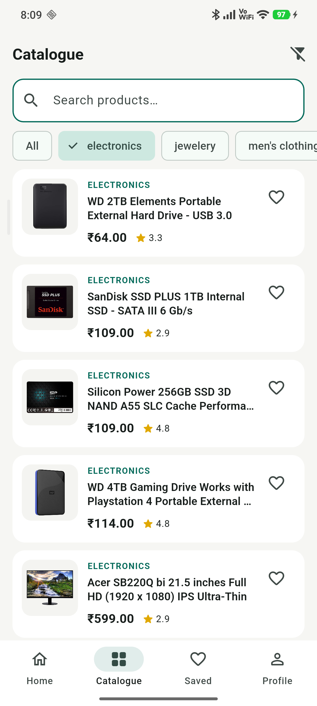
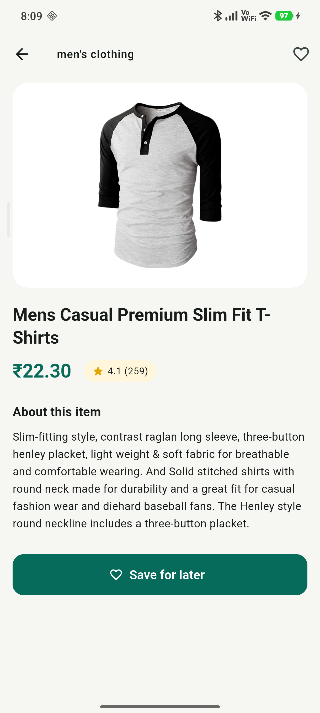
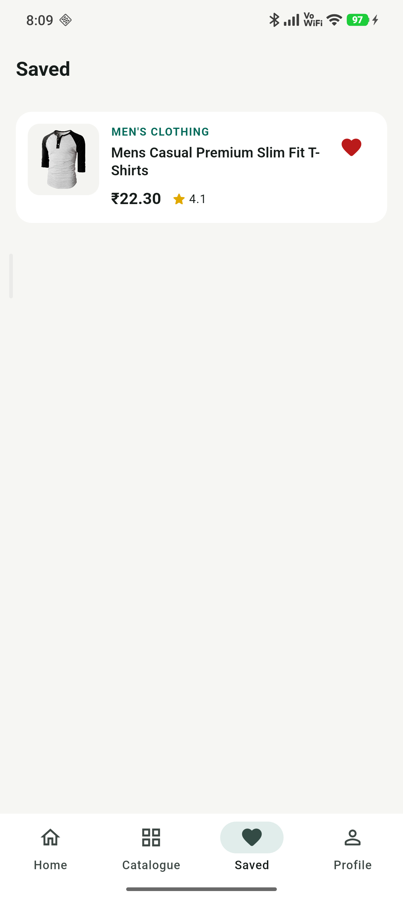
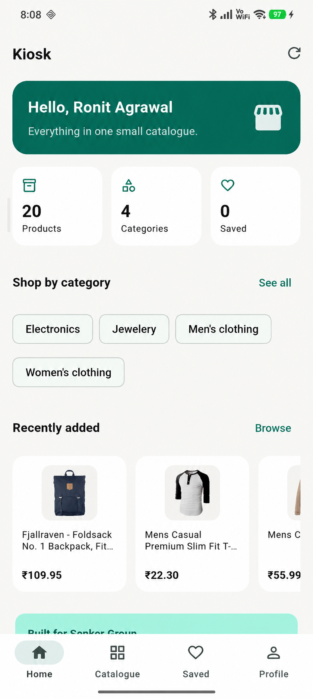
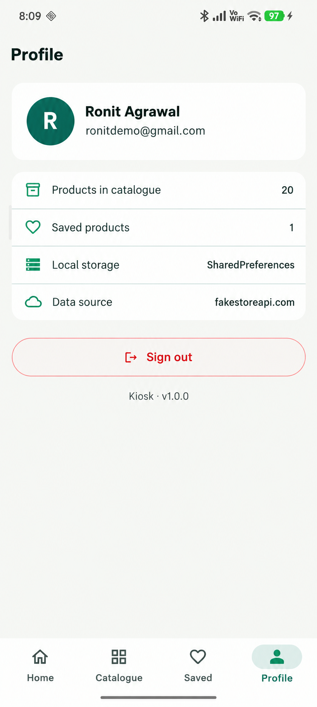
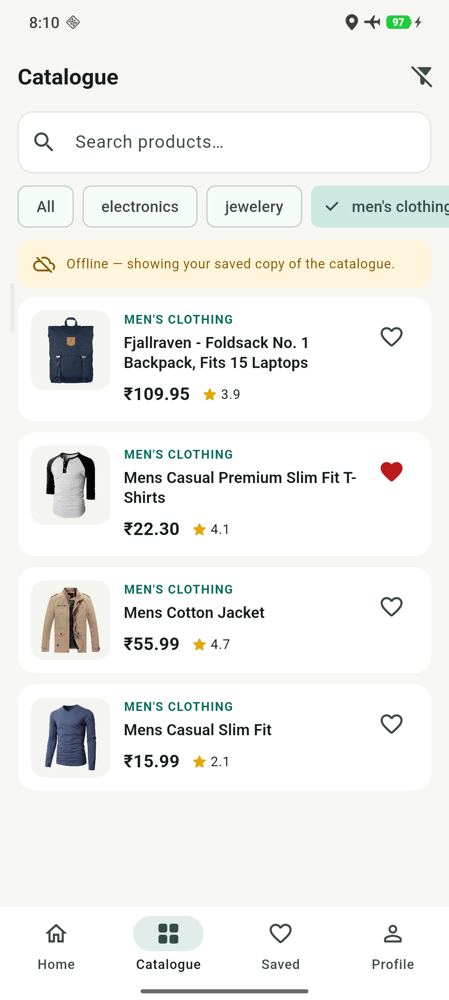

# Kiosk

A small Flutter catalogue app — browse products, search, filter, save favourites
and read the details. Built with a real API, real loading/error/empty handling
and local persistence.

**Live data:** `https://fakestoreapi.com/products`

---

## Screenshots

<table>
  <tr>
    <td></td>
    <td></td>
    <td></td>
  </tr>
  <tr>
    <td></td>
    <td></td>
    <td></td>
  </tr>
  <tr>
    <td></td>
    <td></td>
    <td></td>
  </tr>
  <tr>
    <td></td>
    <td></td>
    <td></td>
  </tr>
</table>

---

## 1. What it does

| Screen | Purpose |
|---|---|
| **Splash** | Brand mark + restores the stored session |
| **Login** | Email + password with validation, inline errors, remembered session |
| **Sign up** | Name, email, password + confirm, all validated |
| **Home** | Greeting, quick stats, category chips, recently added strip |
| **Catalogue** | Full list, live search, category filter, pull to refresh |
| **Details** | Image, price, rating, description, save/unsave |
| **Saved** | Favourites, persisted across app restarts |
| **Profile** | Account info, storage/source info, sign out with confirmation |

**Offline:** the fetched catalogue is cached on device. If the next launch has
no internet, the app shows the cached list with an "Offline" banner instead of
an error screen.

---

## 2. Architecture

```
lib/
├── main.dart                 # app root, registers the two providers
├── models/
│   └── product.dart          # Product + fromJson + search matcher
├── services/
│   ├── api_service.dart      # HTTP call, timeout, ApiException
│   └── auth_service.dart     # local account + session (SHA-256 hashed password)
├── providers/
│   ├── auth_provider.dart    # AuthStatus + sign in / sign up / sign out
│   └── product_provider.dart # LoadStatus, products, search, filter, favourites
├── screens/                  # one file per screen
├── widgets/                  # ProductTile, ProductMiniCard, state views, banner
├── utils/validators.dart     # form validators
└── theme/app_theme.dart      # colours, borders, button and navbar defaults
```

**Pattern:** `Provider` + `ChangeNotifier`. Screens never call the network
directly — they read state from a provider and call its methods. That keeps
widgets free of business logic and makes every screen rebuild-proof.

**Why two providers?** Auth and catalogue change for unrelated reasons. Keeping
them apart means a product refresh never rebuilds the login state, and sign-out
doesn't touch the catalogue.

---

## 3. Packages and why

| Package | Used for |
|---|---|
| `provider` | State management and dependency injection |
| `http` | Calling the FakeStore REST API |
| `shared_preferences` | Session + favourites persistence |
| `crypto` | SHA-256 hashing of the stored password |

No state-management boilerplate, no code generation — deliberately plain Dart so
every line is explainable.

---

## 4. API integration

`ApiService.fetchProducts()` performs a `GET /products` with a 15-second
timeout, then maps each JSON object through `Product.fromJson`.

Three failure paths are handled explicitly:

1. **Non-200 response** → `ApiException` with the status code.
2. **Unparseable body** → `ApiException`.
3. **Network/timeout** → friendly "check your connection" message.

`ProductProvider` converts those into `LoadStatus.error`, and the UI renders
`ErrorView` with a **Try again** button. While the request is running the UI
shows `LoadingView`. An empty result shows `EmptyView` with a reset action.

---

## 5. Data management

* **Session:** `auth.signed_in`, `auth.email`, `auth.name`, `auth.password_hash`
* **Favourites:** `products.favourites` (list of product ids)
* **Catalogue cache:** `products.cache` (JSON of the last successful fetch)

Passwords are stored only as a SHA-256 hash — never in plain text. Favourites
are re-read on every cold start, which is what proves persistence.

---

## 6. Running it

```bash
flutter pub get
flutter run                # phone or emulator
flutter build apk --release
```

Release APK: `build/app/outputs/flutter-apk/app-release.apk`

Tests:

```bash
flutter test               # 13 unit tests: validators, JSON parsing, provider
flutter analyze            # no issues
```

---

## 7. Notes for Sankar Group

The listing → details → search → favourites flow is domain-agnostic. It maps
directly onto **Aasthi**: swap `Product` for a `Property` model (title, price,
locality, area, images) and the API, provider, listing and search layers stay
unchanged. The only new work would be a filter row for BHK, budget and locality.

Demo account for reviewers: create any account from the Sign up screen — it is
stored on the device only.
